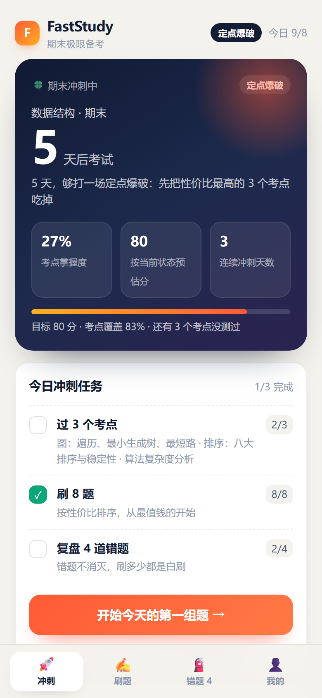
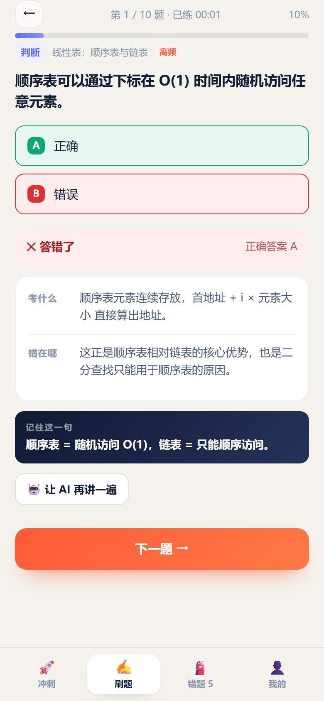

# FastStudy · 大学生期末极限备考

> 平时欠的知识，期末一起还。
> 一个按「还剩几天考试」切换教学策略的 AI 备考小程序（H5 优先，架构为微信小程序预留）。

**在线 Demo**：<https://denghui1835.github.io/faststudy/>
**Demo 直达（带演示数据）**：<https://denghui1835.github.io/faststudy/?demo=1>



---

## 这是什么

期末只剩几天、课还没学会的时候，大多数工具都在劝你「系统学习」——但已经来不及了。

FastStudy 只解决一个问题：**用最短的时间，尽可能多拿分。**

它不假装自己知道老师的卷子，而是把「时间」当成一等公民：

| 距考时间 | 策略 | 系统怎么变 |
|---|---|---|
| ≥ 14 天 | **系统重建** | 先铺满考点，再攻高频题，不跳章节 |
| 4 – 13 天 | **定点爆破** | 按性价比排序（考频 ÷ 你的掌握度），只刷最值钱的 |
| ≤ 3 天 | **保命模式** | 自动切档：只出高频 + 中低难度题，绝不开新章节 |

同一个界面、同一套题库，因为倒计时不同，**给你的东西完全不同**——这才是「期末冲刺」和「题库 App」的区别。

## 核心功能（v0.1 已实现）

- **创建抢救计划**：科目 / 距考天数 / 目标分 / 当前基础 → 生成策略与今日任务
- **AI 引导式刷题**：不会的题先给「怎么想」（三段引导），再让你自己选；判错后才给答案与讲解，避免一上来就被喂答案
- **三段式讲解**：考什么 → 错在哪 → 记住这一句（可背的结论）
- **错题急救本**：自动收集，按考点聚合，答对即出本
- **学习看板**：考点掌握度（按考频加权）、预估分、连续冲刺天数、正确率
- **保命模式开关**：时间不够时一键压缩计划
- **AI 诊断**：一组题做完给出「本组战绩 + 最弱的洞 + 下一步动作」
- **自带模型**：可填入自己的大模型接口（DeepSeek / OpenAI 兼容），不填也能用本地讲解引擎



## 题库

内置 6 门课、82 道手写题，每题都带「考什么 / 错在哪 / 记住这一句」三段讲解：

| 课程 | 考点 | 题量 |
|---|---|---|
| 数据结构 | 8 | 32 |
| 高等数学 | 7 | 12 |
| 线性代数 | 6 | 10 |
| 概率论与数理统计 | 6 | 10 |
| 马克思主义基本原理 | 5 | 10 |
| 大学英语 | 5 | 10 |

题目按考点标注考频（高频 / 常考 / 了解）与难度，这是「性价比排序」的依据。

## 怎么跑

```bash
npm install
npm run dev      # http://localhost:5173
npm run build    # 产物在 dist/，纯静态，丢哪都能跑
```

数据全部存在浏览器 localStorage，不需要后端，也不需要登录。

## 技术

```
React 19 + TypeScript + Vite    纯静态，无后端，无数据库
        │
        ├── src/data/            题库与考点（6 门课，纯数据）
        ├── src/lib/plan.ts      策略引擎：倒计时 → 模式 → 任务 → 队列排序
        ├── src/lib/ai.ts        引导式讲解 / 诊断 / 可选大模型接口
        ├── src/store.tsx        状态 + localStorage 持久化
        └── src/screens/         引导、冲刺、刷题、错题、我的
```

- **策略引擎**是纯函数：`buildPlan(course, exam, progress, lifesaver)`，可单测、可迁移
- **AI 层**分两支：本地规则引擎（零依赖、离线可用）+ 可选 LLM（用户自带 Key，直连 OpenAI 兼容接口）
- **微信小程序适配**：题库、策略引擎、诊断逻辑与渲染无关，迁移路径见 [docs/小程序适配.md](docs/小程序适配.md)

## 设计取舍

- **不做通用学习平台**。期末冲刺要的是「最短路径拿分」，功能越少越锋利。
- **不猜题**。押题依据是「考频标注 + 你的掌握度」，不是模型幻觉出来的「必考」。
- **不喂答案**。先引导、再判、后讲解——考场没有 AI 陪你。
- **不设付费墙、不收算力**。模型接口用户自带，Key 只存本机。

## 路线图

| 版本 | 内容 | 状态 |
|---|---|---|
| v0.1 | 计划创建、策略引擎、引导刷题、错题本、看板 | ✅ 已完成 |
| v0.2 | 上传课件/往年卷 → 自动抽取考点（PDF 解析 + 入库） | ⬜ |
| v0.3 | 模拟考试（限时套卷 + 薄弱点报告） | ⬜ |
| v0.4 | 室友组队冲刺（同步进度、互相监督） | ⬜ |
| v1.0 | 微信小程序正式版（登录、云同步、分享裂变） | ⬜ |

## 参赛

首届中国农业大学 AgriHackathon 农客松 · 主赛道「人类与学习」。
完整的作品介绍、原创声明与 AI 使用说明见 [docs/参赛说明.md](docs/参赛说明.md)。

## 许可

MIT。题库内容为原创，可自由取用与改编。
