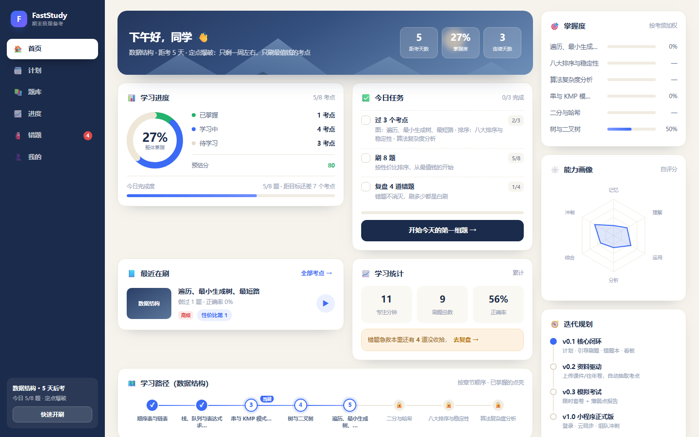
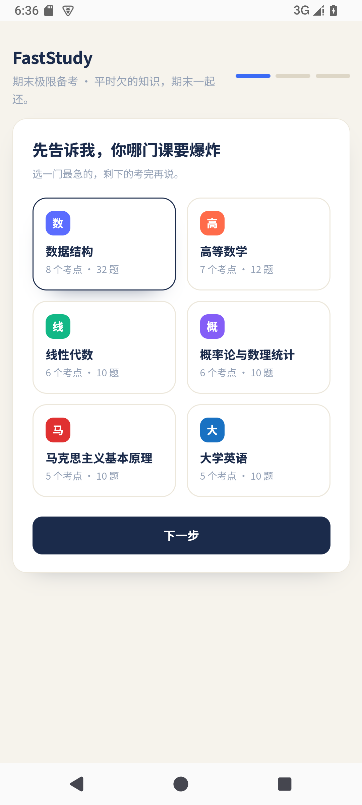
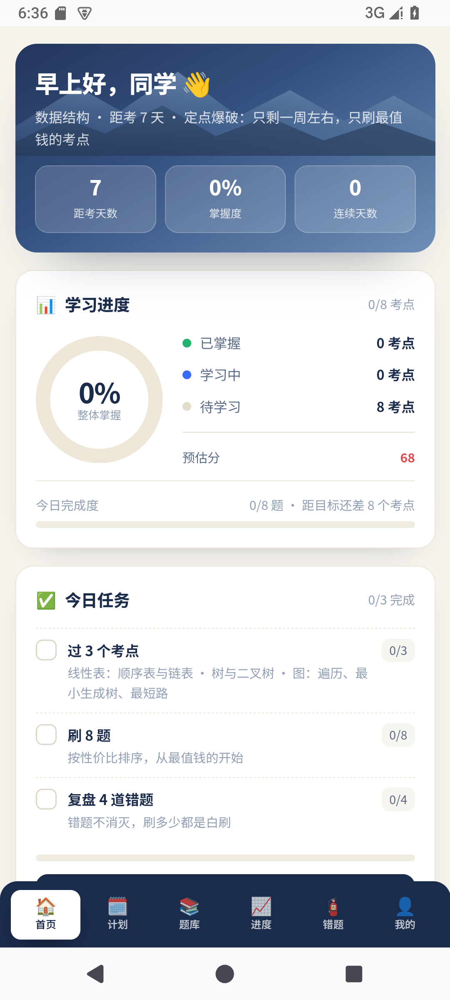
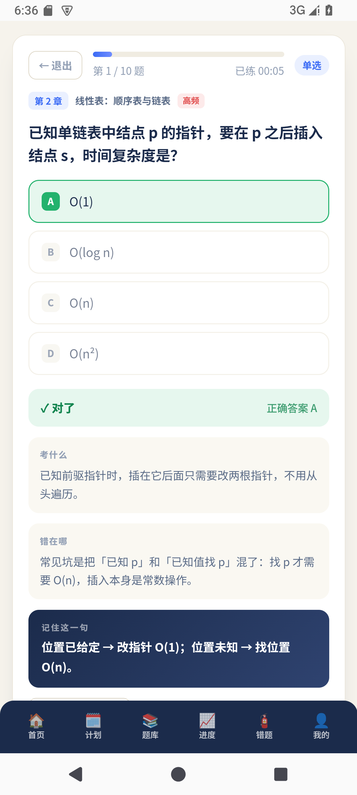
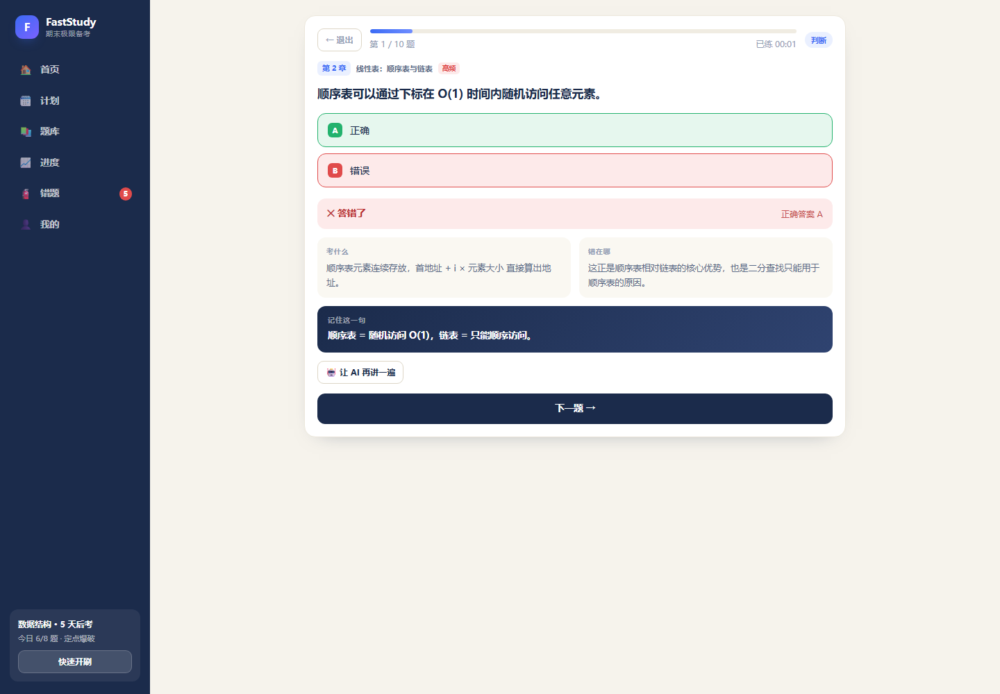

# FastStudy · 大学生期末极限备考

> 平时欠的知识，期末一起还。
> 按「还剩几天考试」切换教学策略的 AI 备考 App：网页版（桌面仪表盘 + 手机自适应）+ **安卓安装包**。

**在线 Demo**：<https://denghui1835.github.io/faststudy/>
**带演示数据直达**：<https://denghui1835.github.io/faststudy/?demo=1>
**安卓 APK（9.6 MiB）**：<https://github.com/denghui1835/faststudy/releases/latest/download/FastStudy-v0.1-android.apk>



---

## 三个入口，同一套代码

| 入口 | 怎么用 | 说明 |
|---|---|---|
| 🌐 网页版 | 直接打开 Demo 链接 | 桌面是仪表盘，手机自动切成底部 tab |
| 📱 安卓 APK | 下载安装（Android 7.0+） | Capacitor 打包的同一套 H5，**纯离线可用**，图标/启动图已定制 |
| 📦 源码 | `npm install && npm run dev` | 纯静态，无后端 |

安卓版实机截图（模拟器 Android 16 / 1080×2400）：

<p>
  
  
  
</p>

想直接扫码体验 / 拉票转发，用这张图（网页版、APK、源码三个码都在）：


---

## 这是什么

期末只剩几天、课还没学会时，大多数工具都在劝你「系统学习」——但已经来不及了。

FastStudy 只解决一个问题：**用最短的时间，尽可能多拿分。**

它不假装知道老师的卷子，而是把「时间」当成一等公民：

| 距考时间 | 策略 | 系统怎么变 |
|---|---|---|
| ≥ 14 天 | **系统重建** | 先铺满考点，再攻高频题，不跳章节 |
| 4 – 13 天 | **定点爆破** | 按性价比排序（考频 ÷ 你的掌握度），只刷最值钱的 |
| ≤ 3 天 | **保命模式** | 自动切档：只出高频 + 中低难度题，绝不开新章节 |

同一个界面、同一套题库，因为倒计时不同，**给你的东西完全不同**——这才是「期末冲刺」和「题库 App」的区别。

## 页面

| 页面 | 内容 | 截图 |
|---|---|---|
| 引导 | 三步创建抢救计划（科目 / 天数 / 目标与基础），桌面版左侧带产品卖点 | [d-onboard](docs/shots/d-onboard.png) |
| 首页 | 倒计时问候、学习进度环、今日任务、最近在刷、学习路径、掌握度、能力画像、迭代规划 | [d-home](docs/shots/d-home.png) |
| 计划 | **课程总览**（每门课到哪了，点一行切课）· 当前策略、今日任务、今日考点、策略切换说明、保命模式开关 | [d-plan](docs/shots/d-plan.png) |
| 题库 | 9 门课 · **课程检索 + 关键词检索**双入口（找课上、找题下）· **学校 / 考频 / 收藏 三级筛选** · 考点清单（考频 / 已练 / 掌握度）· 单点练题 | [d-bank](docs/shots/d-bank.png) |
| 刷题 | 引导 → 作答 → 判错讲解（考什么 / 错在哪 / 记住这一句）→ 本组诊断 | [d-quiz-feedback](docs/shots/d-quiz-feedback.png) ｜ [本组结果](docs/shots/d-result.png) |
| 进度 | 专注时长、刷题量、正确率、掌握度分布、能力雷达、考点明细 | [d-progress](docs/shots/d-progress.png) |
| 错题 | 错题急救本，按考点聚合，答对自动出本 | [d-mistakes](docs/shots/d-mistakes.png) |
| 我的 | 冲刺档案与段位、大模型接口配置、数据与版本 | [d-me](docs/shots/d-me.png) |

手机上侧边栏自动变成底部 tab，卡片单列堆叠：[手机版首页](docs/shots/m-home.png) ｜ [手机版刷题](docs/shots/m-quiz.png) ｜ [手机版引导](docs/shots/m-onboard.png)



## 核心功能（v0.1 已实现）

- **创建抢救计划**：科目 / 距考天数 / 目标分 / 当前基础 → 生成策略与今日任务
- **AI 引导式刷题**：不会的题先给「怎么想」（三段引导），再让你自己选；判错后才给答案与讲解
- **三段式讲解**：考什么 → 错在哪 → 记住这一句（可背的结论）
- **模拟考试**：按考频组卷、限时答题、不给即时反馈、到点自动交卷 → 薄弱点报告 + 错题回顾
- **课程检索**：课程会越加越多，「找课」单独一个入口——课名 / 简称 / 任意考点名 / 章节都能定位到课；命中考点时会点名「二叉树 → 数据结构 · 树与二叉树」，点一下切课；顶部课程 chip 改为横向滚动，不再被课量撑成两行
- **关键词检索**：另一个框专门搜题——题干 / 选项 / 三段讲解 / 考点名 / 章节 / **资料出处**，命中词高亮、展开即看答案与讲解；支持多关键词（空格分隔，全命中才算）；`1` / `2` 分别聚焦两个检索框、Esc 清空；可切「本课程 / 全部 9 门课」，跨课程命中可一键切课去练
- **三级筛选（垂直领域检索）**：学校 → 考频 → 收藏，三段可点标签叠在搜索框上逐级收窄；关键词留空也能按「农大 + 高频」把校本题整批列出来
- **♥ 收藏夹**：题目右侧点爱心收进来，考前只看收藏的题
- **资料原稿下载**：带 `materials` 的课程（如画法几何）在题库页展示原卷 / 官方答案 / 本校课件，支持「看原稿」与「下载」，题目与原件对得上
- **错题急救本**：自动收集，按考点聚合，答对即出本（考试错题也会进本）
- **学习看板**：掌握度环 / 分布、能力雷达、连续冲刺天数、正确率、预估分
- **保命模式开关**：时间不够时一键压缩计划
- **AI 诊断**：一组题做完给出「本组战绩 + 最弱的洞 + 下一步动作」
- **自带模型**：可填自己的大模型接口（DeepSeek / OpenAI 兼容），不填也能用本地讲解引擎

## 题库

内置 9 门课、208 道手写题，每题都带「考什么 / 错在哪 / 记住这一句」三段讲解：

| 课程 | 考点 | 题量 | 资料出处 |
|---|---|---|---|
| 数据结构 | 8 | 40 | 通用 |
| 高等数学 | 7 | 20 | 通用 |
| 线性代数 | 6 | 17 | 通用 |
| 概率论与数理统计 | 6 | 17 | 通用 |
| 马克思主义基本原理 | 5 | 17 | 通用 |
| 大学英语 | 5 | 17 | 通用 |
| 大学物理 | 4 | 12 | 通用 |
| 计算机网络 | 4 | 12 | 通用 |
| 画法几何与工程制图 | 10 | 56 | **中国农业大学**（60100006） |

题目按考点标注考频（高频 / 常考 / 了解）与难度，这是「性价比排序」和「模拟考组卷」的依据。

**资料出处是一等公民**：每门课都带 `source`（学校 + 依据）与可选 `materials`（原卷 / 答案 / 课件），题库页能直接下载原件。画法几何这门课的 56 题就是按 2024 秋样题卷面结构自编的，原卷、官方答案、本校课件都在页面上一键可取——「这是哪来的题」必须答得出来。

**三级筛选**：一个搜索框 + 学校 / 考频 / 收藏三段可点标签，可以空着关键词直接按「农大 + 高频」把所有校本题捞出来。

## 怎么跑

```bash
npm install
npm run dev      # http://localhost:5173
npm run build    # 产物在 dist/，纯静态，丢哪都能跑
```

数据全部存在浏览器 localStorage，不需要后端，也不需要登录。

演示数据：访问 `?demo=1` 会自动注入一份「听过课但没掌握」的样例进度，方便快速查看完整界面。

## 技术

```
React 19 + TypeScript + Vite     纯静态，无后端，无数据库
        │
        ├── src/data/             题库与考点（9 门课，纯数据）
        ├── src/lib/plan.ts       策略引擎：倒计时 → 模式 → 任务 → 队列排序
        ├── src/lib/search.ts     课程检索 + 题目检索：多关键词 AND、字段加权打分、高亮切片（纯函数）
        ├── src/lib/ai.ts         引导式讲解 / 诊断 / 可选大模型接口
        ├── src/components/       Donut / Radar / 山脉横幅（手写 SVG，零图表库）
        ├── src/store.tsx         状态 + localStorage 持久化
        └── src/screens/          首页、计划、题库、刷题、进度、错题、我的
```

- **策略引擎**是纯函数：`buildPlan(course, exam, progress, lifesaver)`，可单测、可迁移
- **图表**全部手写 SVG（环形进度、雷达、路径时间轴），不引第三方图表库
- **响应式**：桌面为侧边栏仪表盘，≤860px 自动切为底部 tab + 单列卡片
- **AI 层**分两支：本地规则引擎（零依赖、离线可用）+ 可选 LLM（用户自带 Key，直连 OpenAI 兼容接口）
- **微信小程序适配**：题库、策略引擎、诊断逻辑与渲染无关，迁移路径见 [docs/小程序适配.md](docs/小程序适配.md)

## 设计取舍

- **不做通用学习平台**。期末冲刺要的是「最短路径拿分」，功能越少越锋利。
- **不猜题**。押题依据是「考频标注 + 你的掌握度」，不是模型幻觉出来的「必考」。
- **不喂答案**。先引导、再判、后讲解——考场没有 AI 陪你。
- **不设付费墙、不收算力**。模型接口用户自带，Key 只存本机。

## 路线图

| 版本 | 内容 | 状态 |
|---|---|---|
| v0.1 | 计划创建、策略引擎、引导刷题、错题本、仪表盘看板 | ✅ 已完成 |
| v0.1 | 模拟考试（限时套卷 + 薄弱点报告）、安卓 APK | ✅ 已完成 |
| v0.2 | 上传课件 / 往年卷 → 自动抽取考点（PDF 解析 + 入库） | ⬜ |
| v0.3 | 室友组队冲刺（进度同步、互相监督） | ⬜ |
| v1.0 | 微信小程序正式版（登录、云同步、分享裂变） | ⬜ |

## 参赛

首届中国农业大学 AgriHackathon 农客松 · 主赛道「人类与学习」。
作品介绍、原创声明与 AI 使用说明见 [docs/参赛说明.md](docs/参赛说明.md)，提交用逐字段文案见 [docs/一键粘贴.md](docs/一键粘贴.md)。

## 许可

MIT。题库内容为原创，可自由取用与改编。
